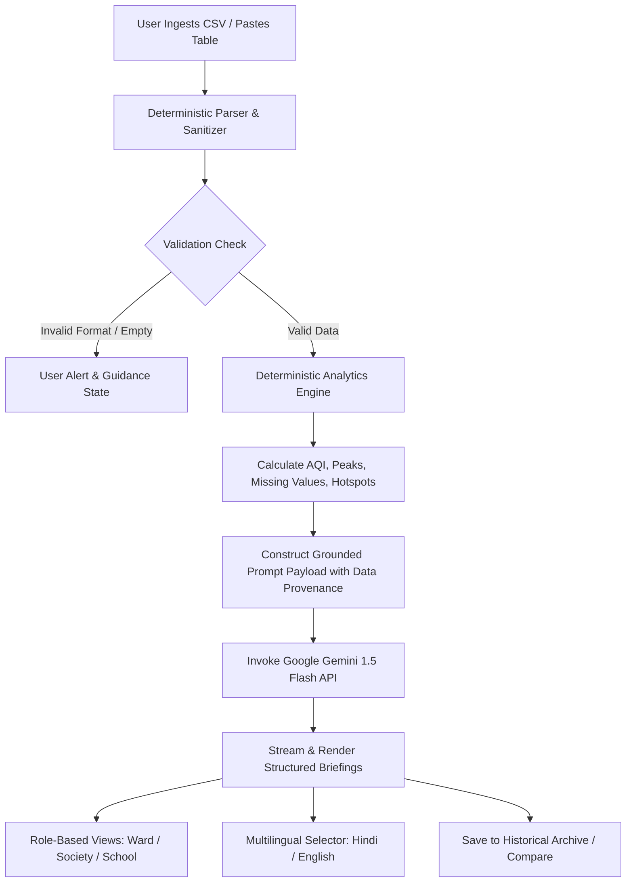

# Civic Air Quality Briefing Studio — Project Specification

> **Document Version:** 1.0.0  
> **Status:** Approved Baseline  
> **Context:** PromptWars — Warm-up Challenge

---

## 1. Official Problem Statement

Urban civic leaders, frontline municipal officers, residential housing managers, and educational administrators face severe challenges during escalating air-pollution episodes. Environmental sensing networks and public monitors generate fragmented, noisy, and unstandardized datasets across disparate units ($\mu\text{g}/\text{m}^3$, $\text{ppm}$, sub-indices) with frequent sensor dropouts, uncalibrated drift, and missing timestamps. 

Current dashboards either present incomprehensible raw numbers or generic city-wide alerts that fail to provide operational clarity. Frontline decision-makers lack the tools to:
1. Ingest messy tabular data and validate its statistical integrity.
2. Translate complex micro-climate air trends into role-specific actions (e.g., road-sweeping routes vs. school recess closures).
3. Generate evidence-backed, multilingual communications calibrated for diverse citizen reading levels.
4. Track and evaluate historical intervention effectiveness across pollution episodes.

The **Civic Air Quality Briefing Studio** solves this breakdown through an evidence-grounded, AI-augmented briefing pipeline.

---

## 2. Product Vision

To serve as an open, resilient civic intelligence platform that empowers municipal authorities, community leaders, and educators to convert noisy air-quality data into rapid, traceable, role-tailored interventions and transparent multilingual public advisories within 60 seconds of data upload.

---

## 3. Target Users & Problem Analysis

| Stakeholder Persona | Key Operational Responsibilities | Core Pain Points Addressed |
| :--- | :--- | :--- |
| **Ward Municipal Officer** | Rapid enforcement: road dust suppression, mechanical sweeping, traffic rerouting, diesel generator bans, construction halts. | Overwhelmed by raw data; needs defensible, ward-specific intervention mandates with legal/operational backing. |
| **Housing Society Facility Manager** | Resident protection: HVAC filter replacement, outdoor ventilation timing, elderly/children recreation schedules. | Generic city alerts do not reflect localized micro-climates or provide actionable HVAC/resident guidelines. |
| **School Administrator / Principal** | Student welfare: morning assembly cancellation, sports suspension, indoor air filtering, asthma emergency readiness. | Fear of liability and confusion over threshold cutoffs for young lung vulnerabilities; requires clear, empathetic parental advisories. |
| **Civic Citizen / Resident** | Daily commutes, outdoor exertion decisions, vulnerable family member care. | Intimidated by technical jargon ($\text{PM}_{2.5}$, $\text{AQI}$ sub-indices); requires clear, culturally localized advice in their native language (e.g., Hindi, English). |

---

## 4. Functional Requirements

### 4.1 Data Ingestion & Sanitization
- **FR-1.1:** Support direct file upload of `.csv` files up to 5MB.
- **FR-1.2:** Support direct paste of raw tab-delimited or comma-separated tabular text.
- **FR-1.3:** Dynamically infer headers and map aliases (e.g., `PM2.5`, `pm_25`, `Particulate Matter 2.5` $\to$ `pm25`).
- **FR-1.4:** Normalize diverse unit representations ($\mu\text{g}/\text{m}^3$, $\text{mg}/\text{m}^3$, $\text{ppm}$, $\text{ppb}$) to standardized metric units.
- **FR-1.5:** Detect and flag sensor anomalies, flatlining (identical repeating values), negative values, and missing time intervals.

### 4.2 Statistical & Spatial Analytics (Deterministic JS)
- **FR-2.1:** Calculate parametric summary statistics: mean, median, 95th percentile, standard deviation, peak values.
- **FR-2.2:** Compute official AQI categories according to Indian National Air Quality Standards (NAAQS) and US-EPA breakpoints.
- **FR-2.3:** Detect spatial-temporal hotspots based on threshold exceedance duration and localized peak variances.
- **FR-2.4:** Quantify data completeness percentage and explicit count of missing timestamps.

### 4.3 AI Briefing & Intervention Synthesis (Google Gemini 1.5 Flash)
- **FR-3.1:** Generate internal administrative briefing notes summarizing incident scale, critical pollutants, and statistical certainty.
- **FR-3.2:** Produce role-specific actionable recommendations mapped directly to Ward Officers, Housing Society Managers, and Schools.
- **FR-3.3:** Generate citizen-facing advisories written in plain language with health risk assessments.
- **FR-3.4:** Support bilingual Hindi and English output generation, with configurable reading levels (Executive Technical vs. Public Simplified).
- **FR-3.5:** Ground every narrative claim with direct evidence tags referencing calculated metrics.

### 4.4 Persistence & Historical Comparison
- **FR-4.1:** Store generated briefings and dataset summaries locally (IndexedDB/LocalStorage) and optionally in Cloud Firestore.
- **FR-4.2:** Provide a visual side-by-side or delta comparison between current and past incident briefings to evaluate whether intervention actions lowered pollutant trends.

---

## 5. Non-Functional Requirements

- **Performance:** Ingestion, parsing, and statistical calculation of 10,000 rows must execute in under 300ms in the client browser.
- **AI Latency:** Full briefing generation with Gemini 1.5 Flash must stream or complete within 5–8 seconds.
- **Reliability:** The application must never crash or produce a blank screen when fed malformed CSV files or unparseable text.
- **Security:** Zero client-side leakage of backend service keys; all client inputs sanitized against XSS before DOM rendering.
- **Accessibility:** Fully accessible according to WCAG 2.1 AA standards; keyboard navigable with semantic HTML markup.

---

## 6. Core Workflows

---

## 7. Scope Boundaries

### In Scope (MVP & Competition Targets)
- Browser-based CSV upload and tabular text paste.
- Deterministic column mapping, unit conversion, and statistical calculation.
- Live Gemini 1.5 Flash prompt synthesis with strict grounding.
- Three dedicated role views (Ward Officer, Housing Society, School Principal).
- Bilingual Hindi / English toggle.
- Local storage and Firestore historical briefing persistence.
- Export options (Markdown / JSON / PDF print view).

### Out of Scope (Planned for Future Releases)
- Direct IoT hardware sensor mesh integration via MQTT/WebSockets.
- Automated municipal GIS dispatch integration (e.g., auto-routing sweepers via municipal APIs).
- Native mobile applications (iOS/Android) — mobile web is prioritized.
- Multi-tenant enterprise SSO beyond standard Firebase Auth.
